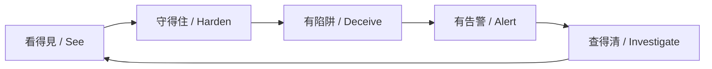
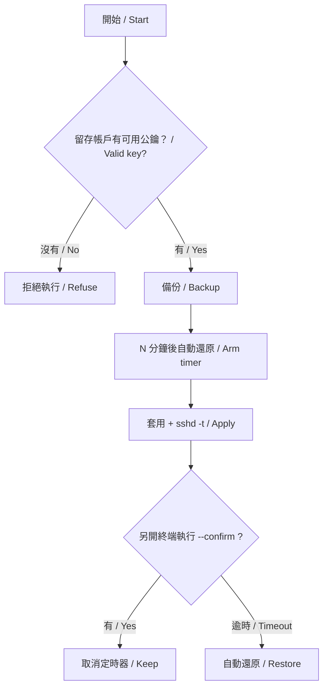
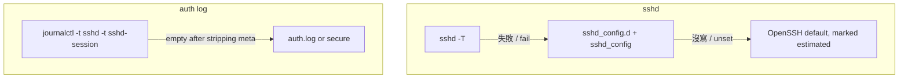

<!--
  oece-x-blue.sh — VPS Blue-Team Hardening Panel
  https://oece-x.com  ·  YouTube @oece-x  ·  Telegram  ·  MIT
-->

<div align="center">


# 🛡️ oece-x-blue.sh

### VPS 藍隊加固面板 — 評分 · 加固 · 蜜罐 · 監控 · 應急響應
### VPS blue-team panel — score, harden, deceive, alert, respond

*單檔 Bash。每一步可回滾。任何動 SSH 的操作都掛自動還原定時器。*  
*One file. Every change is reversible. Every SSH change arms an auto-rollback timer.*

<br/>


<br/>

<p>
  <a href="LICENSE"></a>
  
  
  
  
  
</p>

<p>
  <a href="https://github.com/web3-ai-game/oece-x-blue-sh/stargazers"></a>
  <a href="https://github.com/web3-ai-game/oece-x-blue-sh/network/members"></a>
  
  
  
  
</p>

<p>
  <a href="https://www.youtube.com/@oece-x"></a>
  <a href="https://t.me/+siuGZTKnrNI1OTY1"></a>
  <a href="https://oece-x.com"></a>
  <a href="https://github.com/web3-ai-game/oece-x-sh"></a>
</p>

**繁體中文 / English · 唯讀優先 · 全變更可逆 · 危險操作必須完整輸入 `yes`**

</div>

---

<div align="center">

### 姊妹專案 / Sister project

| 專案 / Project | 回答的問題 / Question | 短命令 / Shortcut |
|:-----|:-----------|:-------|
| [oece-x.sh](https://github.com/web3-ai-game/oece-x-sh) | 這台機器值不值？ / Is this box worth keeping? | `bash <(curl -sL oece-x.com/x)` |
| **oece-x-blue.sh** | 這台機器守不守得住？ / Can this box hold? | `bash <(curl -sL oece-x.com/b)` |

</div>

---

## 快速開始 / Quick start

| 方式 / Method | 命令 / Command |
|:----|:-----|
| 官網便利入口 / Convenience | `bash <(curl -sL oece-x.com/b)` |
| GitHub raw | `bash <(curl -sSL https://raw.githubusercontent.com/web3-ai-game/oece-x-blue-sh/main/oece-x-blue.sh)` |
| 只跑評分 / Score only | `bash oece-x-blue.sh --audit` |
| 英文介面 / English UI | `bash oece-x-blue.sh --lang en` |
| 只看計畫 / Dry-run | `bash oece-x-blue.sh --dry-run` |

需要 root。選單 1–3 唯讀。選單 4 不動 SSH。選單 5 起，動 SSH 或防火牆的步驟會先做 preflight，並掛自動回滾。

Root required. Menus 1–3 are read-only. Menu 4 cannot lock you out. From menu 5 on, SSH and firewall changes arm an auto-rollback timer.

`curl | bash` 是未校驗的便利入口。正式環境請先下載檔案、核對你信任的 SHA256，再執行。

---

## 語言 / Language

優先序 / Precedence：

1. `--lang zh-Hant` 或 `--lang en`，以及 `OECE_LANG`
2. `/etc/oece-x/lang`（選過一次之後，cron 與日報沿用）
3. `LC_ALL` / `LC_MESSAGES` / `LANG`

`zh_CN`、`zh_SG` 與任何 `zh*` **一律使用繁體中文**。`en*` 使用 English。其他語系預設繁體。

首次互動、且還沒有偏好檔時，開場會問一次。10 秒沒輸入就用繁體，並寫入 `/etc/oece-x/lang`。`--audit`、`--confirm`、cron 不提問。

On a Simplified Chinese locale the UI still comes up in Traditional Chinese. That is intentional.

---

## 為什麼需要這個 / Why this exists

大多數 VPS 教學停在「改個 SSH 埠、裝個 fail2ban」。真正的藍隊工作是閉環，而且最大的風險常常是把自己關在門外。

Most tutorials stop at a new SSH port and fail2ban. The loop that actually matters is visibility, hardening, deception, alerting, and forensics. The biggest risk of SSH hardening is locking yourself out.



沒登上去 = 沒確認 = 自動還原。這是整個腳本最重要的設計。

Didn't get back in? Then you never confirmed, and it rolls itself back.



---

## 界面預覽 / Preview

以下是實驗室輸出的版面。IP 使用 [RFC 5737](https://www.rfc-editor.org/rfc/rfc5737) 文件段，不是真實主機。

Lab layout only. Addresses are documentation ranges from RFC 5737, not a live host.

```text
╔══════════════════════════════════════════════════════════════╗
║  OECE-X BLUE · 藍隊態勢面板    07-23 12:38   blue-lab         ║
╚══════════════════════════════════════════════════════════════╝

 加固評分  ▊▊▊▊▊▊▊▊▊▊▊░░░░░░░░░   56/100  偏弱
────────────────────────────────────────────────────────
 防火牆        iptables open
 入侵防禦      未安裝
 24h 失敗登入  34
 蜜罐命中      39  root 30 / admin 9
 Top 攻擊源    203.0.113.10 (24 次)  203.0.113.20 (9 次)  198.51.100.8 (1 次)
────────────────────────────────────────────────────────
 當前會話      deploy@203.0.113.5
 監聽埠        22(sshd) 80(nginx) 443(nginx)
 安全更新      4 個待裝
────────────────────────────────────────────────────────
```

評分明細同樣是唯讀。`SKIP` 不計入分母：沒裝 Docker 不該拉低分數。

`SKIP` is excluded from the denominator. Not running Docker does not cost points.

| 分數 / Score | 評級 / Grade |
|:----:|:----|
| 90–100 | 優秀 / Excellent |
| 75–89 | 良好 / Good |
| 60–74 | 及格 / Passing |
| 40–59 | 偏弱 / Weak |
| 0–39 | 危險 / Critical |

---

## 功能 / Features

| # | 模塊 / Module | 說明 / What it does |
|:-:|:---|:---|
| 1 | 藍隊面板 / Live panel | 評分、封禁、Top 攻擊源、蜜罐、10 秒刷新 |
| 2 | 加固評分 / Audit | 32 項、6 組、修復指引。末行 `score=` 給 cron |
| 3 | Lynis | 第三方第二意見，可選安裝 |
| 4 | 基礎加固 / Basic | 自動更新、sysctl、`/dev/shm`、core dump。零鎖門風險 |
| 5 | 標準加固 / Standard | SSH 收緊、UFW、fail2ban。掛回滾 |
| 6 | 硬核 / Hardcore | 標準 → 蜜罐 → 可選改埠。任一步取消就停 |
| 7 | 逐項 / Cherry-pick | 單項套用。動 SSH 的項自己掛回滾 |
| 8 | CrowdSec | 官方倉庫安裝，不執行遠端腳本。社群情報預設關閉 |
| 9 | fail2ban | sshd jail + recidive |
| 10 | root 蜜罐 / Honeypot | 誘餌名秒封。AllowUsers 保留已有公鑰帳號 |
| 11 | endlessh | 真 SSH 離開 22 且 22 空閒才允許安裝 |
| 12 | 防火牆 / Firewall | UFW、Docker 繞過修復、Cloudflare-only、安全改埠 |
| 13 | 告警通道 / Channels | Telegram / msmtp。憑證只進 `blue.env`（0600） |
| 14 | 登入告警 / Login alert | PAM。地理位置查詢預設關閉 |
| 15 | 日報 / Daily | cron + 配置漂移。讀 `score=` 行 |
| 16 | IOC | 唯讀入侵指標 |
| 17 | 取證包 / Forensics | 打包證據 + `REPORT.md` |
| 18 | 封禁 / Ban | 校驗 IP。拒絕封當前 SSH 來源 |
| 19 | 緊急鎖定 / Lockdown | 只放行當前 IP 的 SSH，保留 80/443 |
| 20 | 回滾 / Rollback | 確認保留、立即還原、manifest |
| 21 | 檢查更新 / Update check | 只比對版本。不自動覆蓋本機檔 |

---

## 架構 / Architecture

三條降級鏈。資料源取不到就降級，不中斷，也不把「讀不到」報成「很安全」。

Three fallback chains. A missing source degrades. It never crashes, and it never reports "unknown" as "safe".



三個真實踩過的坑：

1. 設定檔沒寫 `PasswordAuthentication` 不代表沒開。OpenSSH 預設是 `yes`。
2. `journalctl` 沒資料時印 `-- No entries --`，那不是空字串。不過濾會讓所有統計變成 0。
3. OpenSSH 9.8+ 的工作進程識別碼是 `sshd-session`。只查 `sshd` 會一條都沒有。

---

## 鎖門與救援 / Lockout and recovery

開始前，確認你知道雲商控制台的 VNC 或序列埠在哪裡。

Before you start, know where the provider console is.

| # | 機制 / Control | 做什麼 / What it does |
|:-:|:---|:---|
| 1 | preflight | `ssh-keygen -l` 驗證留存帳戶真的有可用公鑰。沒有就拒絕禁用密碼登入 |
| 2 | rollback timer | 備份後排定 N 分鐘還原。另開終端登入並執行 `--confirm` 才保留 |
| 3 | manifest | `/var/lib/oece-x/manifest.tsv` 記錄做了什麼、怎麼撤銷 |

真的進不去時，用雲商控制台登入，還原 `/var/backups/oece-x/<時間戳>/`，再 reload sshd。回滾路徑必須是備份根下的真實目錄，符號連結會被拒絕。

If you are locked out, use the provider console, restore the timestamped directory under `/var/backups/oece-x/`, and reload sshd. Symlinked rollback paths are rejected.

---

## 主動防禦 / Active defense

機器人大量打 `root`、`admin`、`ubuntu`、`test`。蜜罐把這些名字變成誘餌：真管理員用別的名字，誘餌名第一次嘗試就封。

Bots hammer `root`, `admin`, `ubuntu`, and `test`. The honeypot turns those names into tripwires and bans on the first attempt.

AllowUsers 不會只寫下新管理員一個名字。腳本會列出已有有效公鑰、且不在誘餌名單的帳號，讓你確認後才寫入。否則 reload 後，部署帳號會立刻登不進去。

AllowUsers is not a single new name. Accounts that already have a valid key, and are not decoys, are listed for confirmation before the drop-in is written.

endlessh 有硬前置：真 SSH 必須已離開 22，且 22 必須空閒。否則拒絕安裝。

---

## 隱私 / Privacy

- 零遙測。腳本不上報本機資料。 / No telemetry.
- 蜜罐採到的用戶名、IP、失敗紀錄只留本機。 / Honeypot data stays on the box.
- CrowdSec 社群情報共享預設關閉。要上報必須明確回答 yes。 / CrowdSec sharing is opt-in.
- 登入告警預設只報 IP，不查地理位置。 / Login alerts do not geo-lookup unless you opt in.
- 不含代理或繞過網路封鎖功能。 / No proxy or circumvention features.
- 告警憑證只寫 `/etc/oece-x/blue.env`（`chmod 600`），不進 git。
- 第三方套件走 HTTPS。CrowdSec 用官方倉庫與 `signed-by`，不執行 `curl | bash` 安裝器。

---

## 安全邊界 / Safety boundaries

這支腳本以 root 執行，會改 sshd、防火牆、fail2ban、PAM 與 cron。誤在生產機上跑，仍可能在回滾窗口內中斷服務。程式無法消除這個操作風險。

This tool runs as root and edits sshd, the firewall, fail2ban, PAM, and cron. A mistake on a production host can still interrupt service inside the rollback window.

2.0.0 修過的高風險路徑：

- 蜜罐 AllowUsers 保留既有公鑰帳號，不再只留一個名字。
- 封禁拒絕當前 SSH 來源 IP，並校驗 IPv4/IPv6。
- 緊急鎖定保留 80/443，並在 reset 前備份既有 UFW 規則。
- Cloudflare-only 在清單不完整時不改防火牆；寫入失敗會還原備份。
- `at` 回滾只取消自己記錄的 job id。
- 回滾路徑拒絕符號連結與逃出備份根。
- `sshd_set` 與 `env_set` 用暫存檔覆寫，值裡的引號與 `$` 不會撐破檔案。

漏洞請走 [Security Advisories](https://github.com/web3-ai-game/oece-x-blue-sh/security/advisories/new)，不要在 issue 貼日誌原文。詳見 [SECURITY.md](SECURITY.md)。

---

## 開發 / Development

```bash
bash -n oece-x-blue.sh
shellcheck -S warning oece-x-blue.sh
```

測試矩陣：`debian:12`、`ubuntu:24.04`、`rockylinux:9` 的 `--audit` 降級路徑，以及帶 sshd 的擬真映像。鎖門逃生只在一次性測試機做，做完銷毀機器與測試金鑰。不要在生產機上試。

詳見 [docs/DEV-HANDOFF.md](docs/DEV-HANDOFF.md) 與 [CONTRIBUTING.md](CONTRIBUTING.md)。

---

<details>
<summary><b>English summary</b></summary>

`oece-x-blue.sh` is a single-file Bash blue-team panel. It scores 32 hardening checks, applies changes in tiers, and arms an auto-rollback timer before any SSH or firewall change. The UI is Traditional Chinese by default, including on `zh_CN`, and switches to English with `--lang en`.

Menus 1–3 are read-only. Menu 6 is a cancellable sequence. Menu 21 compares versions and does not overwrite the local file. CrowdSec is installed from the signed package repository, with community signal sharing off unless you opt in.

There is no telemetry, no proxy feature, and no sample upload. Honeypot captures stay on the machine.

</details>

---

<div align="center">


**MIT License** · [YouTube @oece-x](https://www.youtube.com/@oece-x) · [oece-x.com](https://oece-x.com)

*守好你的機器。 / Guard the box.*

</div>
