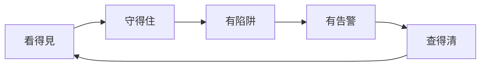
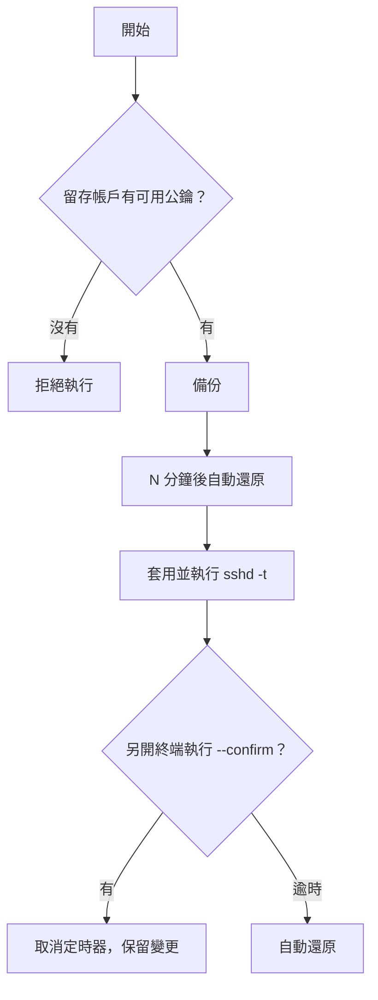
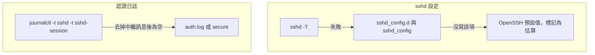
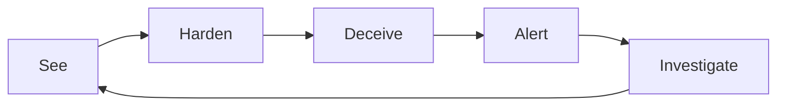
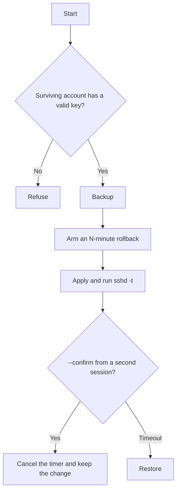
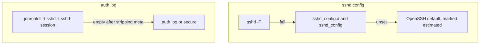

<!--
  oece-x-blue.sh — VPS Blue-Team Hardening Panel
  https://oece-x.com  ·  YouTube @oece-x  ·  Telegram  ·  MIT
-->

<div align="center">


# 🛡️ oece-x-blue.sh

### VPS 藍隊加固面板 — 評分 · 加固 · 蜜罐 · 監控 · 應急響應
### VPS blue-team panel — score, harden, deceive, alert, respond

*單檔 Bash。每一步可回滾。任何動 SSH 的操作都掛自動還原定時器。*  
*One file. Every change is reversible. Every SSH change arms an auto-rollback timer.*

<br/>


<br/>

<p>
  <a href="LICENSE"></a>
  
  
  
  
  
</p>

<p>
  <a href="https://github.com/web3-ai-game/oece-x-blue-sh/stargazers"></a>
  <a href="https://github.com/web3-ai-game/oece-x-blue-sh/network/members"></a>
  
  
  
  
</p>

<p>
  <a href="https://www.youtube.com/@oece-x"></a>
  <a href="https://t.me/+siuGZTKnrNI1OTY1"></a>
  <a href="https://oece-x.com"></a>
  <a href="https://guard-demo.oece-x.com"></a>
  <a href="https://portfolio.oece-x.com"></a>
</p>

**[繁體中文](#zh) · [English](#en)**

</div>

---

<a id="zh"></a>

# 繁體中文

[English](#en)

## 這支腳本做什麼

`oece-x-blue.sh` 是單檔 Bash 藍隊面板。它給機器打 32 項加固分，分級套用變更，並在任何 SSH 或防火牆變更前掛上自動回滾定時器。介面預設繁體中文，包含 `zh_CN` 語系；`--lang en` 切換英文。

選單 1–3 唯讀。選單 6 是可中途取消的組合流程。選單 21 只比對版本，不覆蓋本機檔案。CrowdSec 從簽章倉庫安裝，社群情報預設關閉。

沒有遙測，沒有代理或繞過封鎖功能，不上傳蜜罐樣本。蜜罐資料只留在本機。

## 線上入口

`oece-x.sh` 回答「這台機器值不值」。本專案回答「這台機器守不守得住」。`oece-x.sh` 的倉庫不對外連結。

| 入口 | 做什麼 |
|:-----|:-------|
| [guard-demo.oece-x.com](https://guard-demo.oece-x.com) | 只讀 Web 沙盒。與本腳本 `--demo` 共用 57 / 75 / 83 |
| [portfolio.oece-x.com](https://portfolio.oece-x.com) | 作品集 |
| **oece-x-blue.sh** | 在你自己的 Linux 上評分、加固、回滾 |

## 快速開始

| 方式 | 命令 |
|:-----|:-----|
| 安全落盤執行（推薦） | `curl -fsSL https://raw.githubusercontent.com/web3-ai-game/oece-x-blue-sh/main/oece-x-blue.sh -o oece-x-blue.sh && sudo bash oece-x-blue.sh` |
| 免 Root 終端沙盒 | `bash oece-x-blue.sh --demo` |
| 沙盒 JSON | `bash oece-x-blue.sh --demo --audit --json` |
| 只跑評分 | `sudo bash oece-x-blue.sh --audit` |
| 英文介面 | `bash oece-x-blue.sh --lang en` |
| 繁體介面 | `bash oece-x-blue.sh --lang zh-Hant` |
| 只看計畫 | `sudo bash oece-x-blue.sh --dry-run` |

需要 root。選單 1–3 唯讀。選單 4 不動 SSH。選單 5 起，動 SSH 或防火牆的步驟會先做前置檢查，並掛自動回滾。

`curl | bash` 是未校驗的便利入口。正式環境請先下載檔案、核對你信任的 SHA256，再執行。

## 語言

優先序：

1. `--lang zh-Hant` 或 `--lang en`，以及環境變數 `OECE_LANG`
2. `/etc/oece-x/lang`（選過一次之後，cron 與日報沿用）
3. `LC_ALL`、`LC_MESSAGES`、`LANG`

`zh_CN`、`zh_SG` 與任何 `zh*` 一律使用繁體中文。`en*` 使用英文。其他語系預設繁體。

首次互動且還沒有偏好檔時，開場會問一次。10 秒沒輸入就用繁體，並寫入 `/etc/oece-x/lang`。`--audit`、`--confirm` 與 cron 不提問，避免卡住非互動流程。

## 為什麼需要它

大多數 VPS 教學停在「改個 SSH 埠、裝個 fail2ban」。真正有用的藍隊工作是閉環：看得見、守得住、有陷阱、有告警、查得清。加固 SSH 時，最大的風險常常是把自己關在門外。



沒登上去，就等於沒確認，設定會自動還原。這是整個腳本最重要的設計。



## 界面預覽

以下是實驗室輸出的版面。位址使用 [RFC 5737](https://www.rfc-editor.org/rfc/rfc5737) 文件段，不是真實主機。

終端 `bash oece-x-blue.sh --demo` 與線上只讀沙盒 [guard-demo.oece-x.com](https://guard-demo.oece-x.com) 共用同一套 32 項、6 組評分表（57 → 75 → 83）與 `DO SGP1`（DigitalOcean · Singapore）樣例。六組口徑是 SSH 6、FW 5、IPS 6、TRAP 4、KERN 6、AUD 5。

```text
╔══════════════════════════════════════════════════════════════╗
║  OECE-X BLUE · 藍隊態勢面板    07-23 12:38   blue-lab         ║
╚══════════════════════════════════════════════════════════════╝

 加固評分  ▊▊▊▊▊▊▊▊▊▊▊░░░░░░░░░   56/100  偏弱
────────────────────────────────────────────────────────
 防火牆        iptables open
 入侵防禦      未安裝
 24h 失敗登入  34
 蜜罐命中      39  root 30 / admin 9
 Top 攻擊源    203.0.113.10 (24 次)  203.0.113.20 (9 次)  198.51.100.8 (1 次)
────────────────────────────────────────────────────────
 當前會話      deploy@203.0.113.5
 監聽埠        22(sshd) 80(nginx) 443(nginx)
 安全更新      4 個待裝
────────────────────────────────────────────────────────
```

評分明細同樣是唯讀。`SKIP` 不計入分母：沒裝 Docker 不該拉低分數。

| 分數 | 評級 |
|:----:|:-----|
| 90–100 | 優秀 |
| 75–89 | 良好 |
| 60–74 | 及格 |
| 40–59 | 偏弱 |
| 0–39 | 危險 |

## 功能

| # | 模塊 | 說明 |
|:-:|:-----|:-----|
| 1 | 藍隊面板 | 評分、封禁、Top 攻擊源、蜜罐，10 秒刷新 |
| 2 | 加固評分 | 32 項、6 組、修復指引。末行 `score=` 給 cron |
| 3 | Lynis | 第三方第二意見，可選安裝 |
| 4 | 基礎加固 | 自動更新、sysctl、`/dev/shm`、core dump。零鎖門風險 |
| 5 | 標準加固 | SSH 收緊、UFW、fail2ban。掛回滾 |
| 6 | 硬核 | 標準加固，接著蜜罐，再可選改埠。任一步取消就停 |
| 7 | 逐項 | 單項套用。動 SSH 的項目自己掛回滾 |
| 8 | CrowdSec | 官方倉庫安裝，不執行遠端腳本。社群情報預設關閉 |
| 9 | fail2ban | sshd jail 與 recidive |
| 10 | root 蜜罐 | 誘餌名第一次嘗試就封。AllowUsers 保留已有公鑰的帳號 |
| 11 | endlessh | 真 SSH 離開 22，且 22 空閒，才允許安裝 |
| 12 | 防火牆 | UFW、Docker 繞過修復、Cloudflare-only、安全改埠 |
| 13 | 告警通道 | Telegram 或 msmtp。憑證只進 `blue.env`，權限 0600 |
| 14 | 登入告警 | PAM 鉤子。地理位置查詢預設關閉 |
| 15 | 日報 | cron 與配置漂移偵測。只讀 `score=` 行 |
| 16 | IOC | 唯讀入侵指標掃描 |
| 17 | 取證包 | 打包證據與 `REPORT.md` |
| 18 | 封禁 | 校驗 IP。拒絕封禁當前 SSH 來源 |
| 19 | 緊急鎖定 | 只放行當前 IP 的 SSH，保留 80 與 443 |
| 20 | 回滾 | 確認保留、立即還原、查看 manifest |
| 21 | 檢查更新 | 只比對版本。不自動覆蓋本機檔 |

## 架構

三條降級鏈。資料源取不到就降級，不中斷，也不把「讀不到」報成「很安全」。



三個實際踩過的坑：

1. 設定檔沒寫 `PasswordAuthentication`，不代表沒開。OpenSSH 預設是 `yes`。
2. `journalctl` 沒資料時印出 `-- No entries --`，那不是空字串。不過濾會讓所有統計變成 0。
3. OpenSSH 9.8 以後的工作進程識別碼是 `sshd-session`。只查 `sshd` 會一條都沒有。

## 鎖門與救援

開始前，確認你知道雲商控制台的 VNC 或序列埠在哪裡。

| # | 機制 | 做什麼 |
|:-:|:-----|:-------|
| 1 | 前置檢查 | 用 `ssh-keygen -l` 驗證留存帳戶真的有可用公鑰。沒有就拒絕禁用密碼登入 |
| 2 | 回滾定時器 | 備份後排定 N 分鐘還原。另開終端登入並執行 `--confirm` 才保留 |
| 3 | 變更清單 | `/var/lib/oece-x/manifest.tsv` 記錄做了什麼、怎麼撤銷 |

真的進不去時，用雲商控制台登入，還原 `/var/backups/oece-x/<時間戳>/`，再重新載入 sshd。回滾路徑必須是備份根下的真實目錄，符號連結會被拒絕。

## 主動防禦

機器人大量嘗試 `root`、`admin`、`ubuntu`、`test`。蜜罐把這些名字變成誘餌：真管理員用別的名字，誘餌名第一次嘗試就封。

`AllowUsers` 不會只寫下新管理員一個名字。腳本會列出已有有效公鑰、且不在誘餌名單的帳號，讓你確認後才寫入。否則重新載入後，部署帳號會立刻登不進去。

endlessh 有硬前置：真 SSH 必須已離開 22，且 22 必須空閒。否則拒絕安裝。

## 隱私

- 零遙測。腳本不上報本機資料。
- 蜜罐採到的用戶名、IP 與失敗紀錄只留本機。
- CrowdSec 社群情報共享預設關閉。要上報必須明確回答 yes。
- 登入告警預設只報 IP，不查地理位置。
- 不含代理或繞過網路封鎖的功能。
- 告警憑證只寫 `/etc/oece-x/blue.env`（`chmod 600`），不進 git。
- 第三方套件走 HTTPS。CrowdSec 用官方倉庫與 `signed-by`，不執行遠端安裝腳本。

## 安全邊界

這支腳本以 root 執行，會改 sshd、防火牆、fail2ban、PAM 與 cron。誤在生產機上跑，仍可能在回滾窗口內中斷服務。程式無法消除這個操作風險。

2.0.0 收緊過的高風險路徑：

- 蜜罐的 `AllowUsers` 保留既有公鑰帳號，不再只留一個名字。
- 封禁拒絕當前 SSH 來源 IP，並校驗 IPv4 與 IPv6。
- 緊急鎖定保留 80 與 443，並在重置前備份既有 UFW 規則。
- Cloudflare-only 在清單不完整時不改防火牆；寫入失敗會還原備份。
- `at` 回滾只取消自己記錄的工作編號。
- 回滾路徑拒絕符號連結，也拒絕逃出備份根目錄。
- `sshd_set` 與 `env_set` 先寫暫存檔再覆蓋。值裡的引號與 `$` 不會撐破檔案。

漏洞請走 [Security Advisories](https://github.com/web3-ai-game/oece-x-blue-sh/security/advisories/new)，不要在 issue 貼日誌原文。詳見 [SECURITY.md](SECURITY.md)。

## 開發

```bash
bash -n oece-x-blue.sh
shellcheck -S warning oece-x-blue.sh
```

測試矩陣是 `debian:12`、`ubuntu:24.04`、`rockylinux:9` 的 `--audit` 降級路徑，以及帶 sshd 的擬真映像。鎖門逃生只在一次性測試機做，做完銷毀機器與測試金鑰。不要在生產機上試。

詳見 [docs/DEV-HANDOFF.md](docs/DEV-HANDOFF.md) 與 [CONTRIBUTING.md](CONTRIBUTING.md)。

[回到頁首](#oece-x-bluesh) · [English](#en)

---

<a id="en"></a>

# English

[繁體中文](#zh)

## What this is

`oece-x-blue.sh` is a single-file Bash blue-team panel. It scores 32 hardening checks, applies changes in tiers, and arms an auto-rollback timer before any SSH or firewall change. The UI defaults to Traditional Chinese, including on a `zh_CN` locale. Switch to English with `--lang en`.

Menus 1–3 are read-only. Menu 6 is a sequence you can cancel at each step. Menu 21 compares versions and does not overwrite the local file. CrowdSec is installed from the signed package repository. Community signal sharing stays off unless you opt in.

There is no telemetry, no proxy or circumvention feature, and no sample upload. Honeypot captures stay on the machine.

## Live entry points

`oece-x.sh` answers whether a box is worth keeping. This project answers whether it can hold. The `oece-x.sh` repository is not linked from here.

| Entry | What it is |
|:------|:-----------|
| [guard-demo.oece-x.com](https://guard-demo.oece-x.com) | Read-only web sandbox. Same 57 / 75 / 83 model as `--demo` |
| [portfolio.oece-x.com](https://portfolio.oece-x.com) | Portfolio |
| **oece-x-blue.sh** | Score, harden, and roll back on your own Linux host |

## Quick start

| Method | Command |
|:-------|:--------|
| Verified local run | `curl -fsSL https://raw.githubusercontent.com/web3-ai-game/oece-x-blue-sh/main/oece-x-blue.sh -o oece-x-blue.sh && sudo bash oece-x-blue.sh` |
| Rootless TUI demo | `bash oece-x-blue.sh --demo` |
| Sandbox JSON | `bash oece-x-blue.sh --demo --audit --json` |
| Score only | `sudo bash oece-x-blue.sh --audit` |
| English UI | `bash oece-x-blue.sh --lang en` |
| Traditional Chinese UI | `bash oece-x-blue.sh --lang zh-Hant` |
| Dry-run | `sudo bash oece-x-blue.sh --dry-run` |

Root is required. Menus 1–3 are read-only. Menu 4 does not touch SSH. From menu 5 on, SSH and firewall changes run a preflight check and arm an auto-rollback timer.

`curl | bash` is an unverified convenience entry. On a host you care about, download the file, check a SHA256 you trust, then run it.

## Language

Precedence:

1. `--lang zh-Hant` or `--lang en`, and the `OECE_LANG` environment variable
2. `/etc/oece-x/lang` (used by cron and the daily report after you choose once)
3. `LC_ALL`, `LC_MESSAGES`, then `LANG`

`zh_CN`, `zh_SG`, and any other `zh*` locale use Traditional Chinese. `en*` uses English. Every other locale defaults to Traditional Chinese.

On the first interactive run, if no preference file exists, the script asks once. After 10 seconds with no input it keeps Traditional Chinese and writes `/etc/oece-x/lang`. `--audit`, `--confirm`, and cron never prompt.

## Why it exists

Most VPS guides stop at a new SSH port and fail2ban. The loop that matters is visibility, hardening, deception, alerting, and forensics. The biggest risk of SSH hardening is locking yourself out.



If you do not get back in, you never confirmed, and the change rolls itself back. That is the design.



## Preview

Lab layout only. Addresses are documentation ranges from [RFC 5737](https://www.rfc-editor.org/rfc/rfc5737), not a live host.

`bash oece-x-blue.sh --demo` and the read-only sandbox at [guard-demo.oece-x.com](https://guard-demo.oece-x.com) share one 32-check, 6-group table (57 → 75 → 83) and the `DO SGP1` (DigitalOcean · Singapore) sample. The groups are SSH 6, FW 5, IPS 6, TRAP 4, KERN 6, and AUD 5.

```text
╔══════════════════════════════════════════════════════════════╗
║  OECE-X BLUE · live panel          07-23 12:38   blue-lab     ║
╚══════════════════════════════════════════════════════════════╝

 Score         ▊▊▊▊▊▊▊▊▊▊▊░░░░░░░░░   56/100  Weak
────────────────────────────────────────────────────────
 Firewall      iptables open
 IPS           not installed
 Failed logins 34 in 24h
 Honeypot hits 39  root 30 / admin 9
 Top sources   203.0.113.10 (24)  203.0.113.20 (9)  198.51.100.8 (1)
────────────────────────────────────────────────────────
 Session       deploy@203.0.113.5
 Listening     22(sshd) 80(nginx) 443(nginx)
 Updates       4 security updates pending
────────────────────────────────────────────────────────
```

The score view is read-only. `SKIP` stays out of the denominator. A host without Docker should not lose points for that.

| Score | Grade |
|:-----:|:------|
| 90–100 | Excellent |
| 75–89 | Good |
| 60–74 | Passing |
| 40–59 | Weak |
| 0–39 | Critical |

## Features

| # | Module | What it does |
|:-:|:-------|:-------------|
| 1 | Live panel | Score, bans, top attackers, honeypot hits, refresh every 10 seconds |
| 2 | Audit | 32 checks in 6 groups, plus a fix hint. The last line is `score=` for cron |
| 3 | Lynis | Optional third-party second opinion |
| 4 | Basic harden | Unattended updates, sysctl, `/dev/shm`, core dumps. No lockout risk |
| 5 | Standard harden | SSH, UFW, fail2ban, with a rollback timer |
| 6 | Hardcore | Standard harden, then the honeypot, then an optional port move. Cancel stops the sequence |
| 7 | Cherry-pick | Apply one control. SSH items arm their own rollback timer |
| 8 | CrowdSec | Signed package repository. No remote installer. Community sharing off by default |
| 9 | fail2ban | sshd jail plus recidive |
| 10 | root honeypot | Decoy names are banned on the first attempt. AllowUsers keeps accounts that already have a key |
| 11 | endlessh | Refuses to install unless real SSH has left port 22 and port 22 is free |
| 12 | Firewall | UFW, Docker bypass fix, Cloudflare-only, safe port change |
| 13 | Alert channels | Telegram or msmtp. Credentials go only to `blue.env`, mode 0600 |
| 14 | Login alert | PAM hook. Geo lookup is off unless you opt in |
| 15 | Daily report | cron plus drift detection. Reads the `score=` line |
| 16 | IOC scan | Read-only intrusion indicators |
| 17 | Forensics bundle | Packed evidence plus `REPORT.md` |
| 18 | Ban | Validates the IP. Refuses the current SSH source |
| 19 | Emergency lockdown | Allows SSH only from the current IP, and keeps ports 80 and 443 |
| 20 | Rollback | Confirm, restore now, or read the manifest |
| 21 | Update check | Compares versions. Does not overwrite the local file |

## Architecture

Three fallback chains. A missing source degrades. It does not crash, and it does not report "unknown" as "safe".



Three traps this script already hit:

1. A missing `PasswordAuthentication` line does not mean password auth is off. OpenSSH defaults it to `yes`.
2. An empty `journalctl` prints `-- No entries --`. That is not an empty string. Leaving it in makes every counter read zero.
3. From OpenSSH 9.8 the session process is `sshd-session`. Querying only `sshd` returns nothing.

## Lockout and recovery

Before you start, know where the provider console's VNC or serial port is.

| # | Control | What it does |
|:-:|:--------|:-------------|
| 1 | Preflight | `ssh-keygen -l` must see a valid key on the surviving account. Otherwise password login is not disabled |
| 2 | Rollback timer | After the backup, a restore is scheduled in N minutes. Keep the change only with `--confirm` from a second session |
| 3 | Manifest | `/var/lib/oece-x/manifest.tsv` records what changed and how to undo it |

If you are locked out, use the provider console, restore the timestamped directory under `/var/backups/oece-x/`, and reload sshd. Rollback paths must be real directories under the backup root. Symlinks are rejected.

## Active defense

Bots hammer `root`, `admin`, `ubuntu`, and `test`. The honeypot turns those names into tripwires and bans on the first attempt. The real admin uses a different name.

`AllowUsers` is not a single new name. Accounts that already have a valid key, and are not decoys, are listed for confirmation before the drop-in is written. Otherwise a deploy account loses SSH at reload.

endlessh has a hard precondition: real SSH must already have left port 22, and port 22 must be free. Otherwise the install is refused.

## Privacy

- No telemetry. The script does not upload host data.
- Usernames, IPs, and failed attempts captured by the honeypot stay on the machine.
- CrowdSec community sharing is off unless you explicitly answer yes.
- Login alerts report the IP only. Geo lookup is opt-in.
- No proxy or network-circumvention features.
- Alert credentials are written only to `/etc/oece-x/blue.env` (`chmod 600`). They are not committed.
- Third-party packages are fetched over HTTPS. CrowdSec uses the official repository and `signed-by`. The remote installer script is not executed.

## Safety boundaries

This tool runs as root. It edits sshd, the firewall, fail2ban, PAM, and cron. A mistaken run on a production host can still interrupt service inside the rollback window. Code cannot remove that operational risk.

High-risk paths tightened in 2.0.0:

- Honeypot `AllowUsers` keeps existing key-bearing accounts. It no longer writes a single name.
- Ban refuses the current SSH source IP and accepts only a single IPv4 or IPv6 address.
- Emergency lockdown keeps ports 80 and 443, and snapshots existing UFW rules before reset.
- Cloudflare-only does not touch the firewall when the list is incomplete. A failed write restores the backup.
- The `at` rollback removes only the job id this tool recorded.
- Rollback paths reject symlinks and paths that escape the backup root.
- `sshd_set` and `env_set` write a temp file, then replace. Quotes and `$` in a value cannot break the file.

Report vulnerabilities through [Security Advisories](https://github.com/web3-ai-game/oece-x-blue-sh/security/advisories/new). Do not paste raw logs into an issue. See [SECURITY.md](SECURITY.md).

## Development

```bash
bash -n oece-x-blue.sh
shellcheck -S warning oece-x-blue.sh
```

The test matrix is the `--audit` fallback path on `debian:12`, `ubuntu:24.04`, and `rockylinux:9`, plus a realistic image with sshd. Run the lockout drill only on a disposable machine, then destroy the machine and the one-time SSH key. Do not run it on production.

See [docs/DEV-HANDOFF.md](docs/DEV-HANDOFF.md) and [CONTRIBUTING.md](CONTRIBUTING.md).

[Back to top](#oece-x-bluesh) · [繁體中文](#zh)

---

<div align="center">


**MIT License** · [YouTube @oece-x](https://www.youtube.com/@oece-x) · [oece-x.com](https://oece-x.com)

*守好你的機器。 / Guard the box.*

</div>
